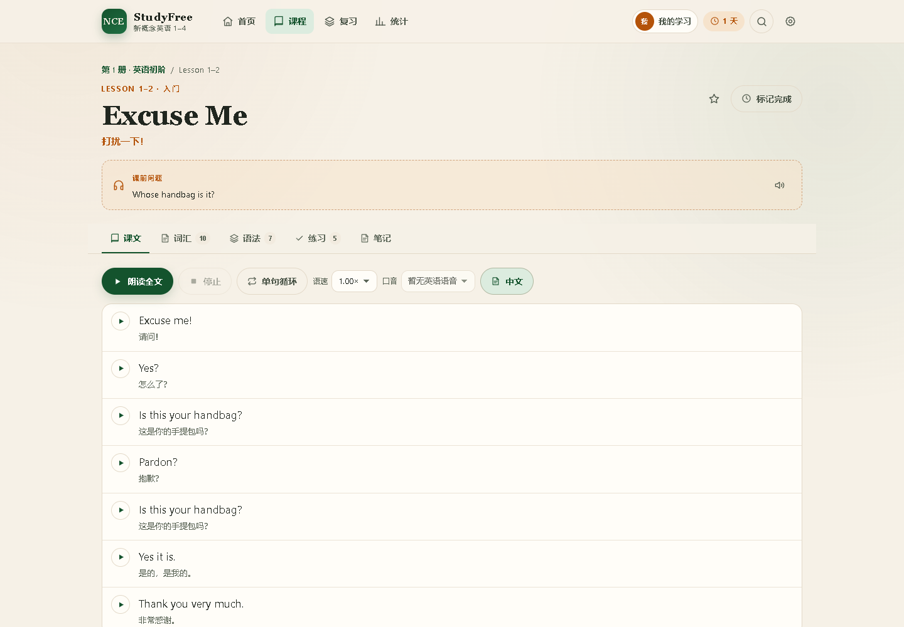
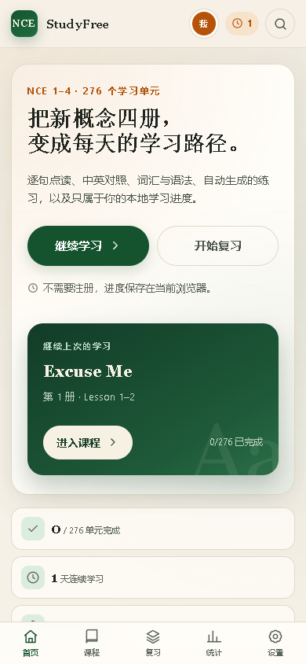

# NCE StudyFree · 新概念英语 1–4 本地学习站

一个**零依赖、纯静态**的新概念英语学习站：逐句点读、中英对照、词汇/语法、自动生成练习、生词间隔重复、错题本、统计、笔记与本地进度。数据覆盖 **4 册 / 276 个学习单元 / 348 课**，可离线使用。

在线站点：<https://cencyzp.github.io/NCEStudyFree/>

> 参考了 [ChinaStudyFree](https://github.com/tanle-mtr/ChinaStudyFree) 的“教材 → 单元 → 互动课程 → 练习 → 复习”信息架构，但本项目只做单端 Web、纯静态、无后端、无账号。

---

## 功能

- **四册完整课程**：第一册 72 个双课单元（144 课），第二/三/四册 96/60/48 课，共 276 个学习单元。
- **课文点读**：逐句朗读、单句循环、全文连读、语速与英语口音选择、中文显示/隐藏/模糊。
- **中英对照**：5,332 句课文，100% 带中文译文；缺失译文会明确标注。
- **词汇学习**：音标、词性、释义、用法、发音，一键加入生词本。
- **语法与句型**：778 个语法点、1,022 个句型模仿与例句。
- **自动生成练习**：每课 4–6 题，涵盖词义选择、拼写、短语填空、课文填空、语法选择、句意选择、听写；即时判分、解析、错题记录。
- **间隔重复**：简化 SM-2，生词按“重来 / 困难 / 记得 / 太简单”评分，自动安排下次复习。
- **错题本**：错题自动收进，支持重做；同一题连续答对两次移出。
- **统计**：四册完成度、连续学习天数、今日正确率、近 7 天答题、最近学习。
- **本地多档案**：同一浏览器内可为家人/学生建立多个独立档案，各自拥有进度、生词、错题和笔记；顶部头像快速切换。
- **笔记 / 收藏 / 完成标记**：全部保存在浏览器本地。
- **搜索**：按课文标题、单词、中文释义、短语检索。
- **PWA 离线**：首次访问后缓存全部 JS 与四册数据，断网仍可学习。
- **深色模式 / 字号调节 / 数据导出导入**。

## 截图

| 首页 | 课程页 |
| --- | --- |
|  |  |

| 练习 | 生词复习 |
| --- | --- |
|  |  |

移动端：



多档案：


## 快速开始

需要 Node.js **20.11+**（仅用于本地静态服务器与数据脚本，站点本身零运行时依赖）：

```bash
git clone https://github.com/CencyZp/NCEStudyFree.git
cd NCEStudyFree
node tools/serve.mjs
# 打开 http://127.0.0.1:5173/
```

没有 Node.js 时也可以用 Python：

```bash
python -m http.server 5173
```

> 请通过本地服务器打开，不要直接双击 `index.html`：ES Modules、Service Worker 与麦克风权限在 `file://` 下会被浏览器限制。

### 可选：安装为应用

在 Chrome / Edge 地址栏右侧点击“安装”，或移动端“添加到主屏幕”。首次访问会下载约 4 MB 课程数据用于离线。

## 使用方式

1. 首页选择一册，进入课程列表。
2. 打开一课，先读“课文”，点击句子听发音；可切换中文、调语速、单句循环。
3. 在“词汇”里把不熟的词加入生词本；“语法”里看结构与例句。
4. 做“练习”，提交后看解析；答错的题自动进入错题本。
5. 到“复习”里清掉到期生词与错题；到“统计”看进度。
6. 点击顶部档案头像，新建/切换学习档案；每个档案的数据完全独立。
7. 在“设置”里导出当前档案或全部档案，换设备时导入。

### 键盘快捷键

| 场景 | 按键 |
| --- | --- |
| 课文 | `Space` 播放/停止；`←` / `→` 上一句/下一句 |
| 练习 | `1`–`4` 选择选项；`Enter` 提交/下一题 |
| 生词复习 | `Space` 翻面；`1`–`4` 评分 |

## 数据与规模

| 指标 | 数量 |
| --- | ---: |
| 册数 | 4 |
| 学习单元 | 276 |
| 课数 | 348 |
| 课文句子 | 5,332 |
| 双语覆盖率 | 100% |
| 词汇条目 | 3,968 |
| 短语 | 2,427 |
| 语法点 | 778 |
| 句型 | 1,022 |
| 练习题 | 1,654 |

数据构建报告见 [`docs/data-report.json`](docs/data-report.json)。

## 项目结构

```text
.
├── index.html                  # 应用入口
├── 404.html                    # Pages 404 回首页
├── manifest.webmanifest        # PWA 清单
├── sw.js                       # Service Worker（离线缓存）
├── css/styles.css              # 全部样式
├── js/
│   ├── app.js                  # 路由、壳层、数据加载
│   ├── router.js               # hash 路由
│   ├── profiles.js             # 本地多档案注册表与切换
│   ├── store.js                # localStorage 状态
│   ├── srs.js                  # 间隔重复算法
│   ├── exercises.js            # 判分
│   ├── ui.js / tts.js / recorder.js
│   └── views/                  # 首页/册页/课程/复习/统计/设置/搜索
├── assets/icons/               # PWA / favicon 图标
├── data/                       # 构建产物（可直接加载的 JS 数据）
├── sources/                    # 抓取的 LRC 与 notes 原始数据
├── tools/                      # 抓取、构建、校验、服务器、图标、冒烟测试
├── tests/                      # Node 单元测试
└── docs/                       # 构建报告与截图
```

## 开发与验证

```bash
node tools/fetch-sources.mjs    # 下载 276 份 LRC + notes（已提交，可跳过）
node tools/build-data.mjs       # 生成 data/*.js
node tools/validate-data.mjs    # 校验 4 册 / 276 单元 / 题量与双语率
node --test                     # 32 个逻辑单测
node tools/serve.mjs            # 本地预览
```

浏览器冒烟测试（可选，使用系统 Edge；先另开一个终端运行 `node tools/serve.mjs`）：

```bash
npm install
node tools/smoke.mjs
```

覆盖：首页/册页/课程/练习/持久化/生词复习/搜索/统计/设置/多档案入口/深色主题/离线/390px 移动端。

重新生成图标需要 Python + Pillow（仅修改品牌图标时需要）：

```bash
python tools/make-icons.py
```

## 数据来源与版权

- 课文与中文译文：来自 [iChochy/NCE](https://github.com/iChochy/NCE) 的公开 LRC 数据（代码 MIT；中文译文由该项目使用 Gemini AI 生成）。抓取快照：2026-10-26。
- 词汇、短语、语法、句型：来自 [LiDuoMiao/new-concept-english](https://github.com/LiDuoMiao/new-concept-english)（MIT）的课级笔记，AI 辅助整理。
- 信息架构参考：[ChinaStudyFree](https://github.com/tanle-mtr/ChinaStudyFree)（MIT）。

**《新概念英语》课文、译文、音频的版权归原作者 L.G. Alexander、出版社及其他权利人所有。** 本站不内置官方音频，不提供下载，不以盈利为目的，仅供个人学习与研究。若权利人认为内容不当，请在本仓库提 Issue，我会尽快删除相关内容。

代码以 [MIT](LICENSE) 发布；**MIT 许可不覆盖课文、译文、词汇/语法笔记等第三方内容**，详见 [NOTICE.md](NOTICE.md)。

## 隐私

- 无账号、无后端、无统计脚本、无第三方请求。
- 档案注册表存在 `nce-study:profiles:v1`；每个档案的学习进度、生词、错题、笔记分别存在 `nce-study:v1:<profileId>`。
- 旧版单档案数据会自动迁移为“我的学习”，原 `nce-study:v1` 保留为备份。
- 换设备请用“设置 → 导出全部档案 / 导入全部档案”，或在档案内单独导出当前档案。

## 已知限制

- 朗读依赖浏览器内置的英语语音包；不同系统的音色与可用性不同。
- 句级译文覆盖 100%；部分课程（尤其第二册）没有独立的中文标题，界面显示英文标题。
- 中文译文和词汇/语法笔记由 AI 辅助生成，可能存在个别错误；欢迎提 Issue 纠错。
- 录音需要麦克风权限与 HTTPS/localhost；不做自动发音评分。
- 多档案只存在于当前浏览器，不会自动跨设备同步；换设备请导入全部档案备份。
- 首次访问需联网加载；之后可离线使用。
- 不是新概念英语官方产品。

## 致谢

- [ChinaStudyFree](https://github.com/tanle-mtr/ChinaStudyFree) — 学习路径与互动课程的产品参考。
- [iChochy/NCE](https://github.com/iChochy/NCE) — 双语课文与时间轴数据。
- [LiDuoMiao/new-concept-english](https://github.com/LiDuoMiao/new-concept-english) — 课级词汇/语法笔记。
- 所有在新概念英语教学与开源社区中分享资料的人。

## License

代码：[MIT](LICENSE)。内容：见 [NOTICE.md](NOTICE.md)。
